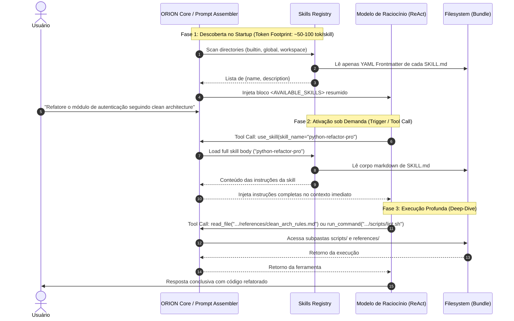

# ORION-Agent — Especificação do Universal Agent Skills Standard

> Especificação arquitetural do subsistema de Habilidades Modulares (*Skills*) do O.R.I.O.N, aderente ao padrão aberto de mercado adotado por Claude Code, Google Antigravity e OpenHands.

---

## 1. Visão Geral & Motivação

Historicamente, sistemas de IA tentaram injetar todas as instruções, diretrizes de código e regras operacionais diretamente no *System Prompt*. Esse padrão resulta em:
1. **Context Bloat:** Milhares de tokens gastos no prompt antes mesmo de o usuário digitar a primeira palavra.
2. **Context Degradation & Distração:** Modelos perdem a atenção aos comandos principais quando o prompt está sobrecarregado com regras de ferramentas não utilizadas.
3. **Rigidez:** Impossibilidade de estender as capacidades do agente sem alterar o código-fonte central ou reescrever prompts globais.

O **O.R.I.O.N** resolve esse problema implementando o **Universal Agent Skills Standard** (`SKILL.md`), desacoplando o conhecimento operacional em pacotes modulares e autônomos que operam sob o princípio de **Divulgação Progressiva (*Progressive Disclosure*)**.

---

## 2. Anatomia de uma Habilidade (*Skill Bundle*)

Cada habilidade é representada por um diretório autônomo contendo obrigatoriamente um arquivo `SKILL.md` e pastas opcionais de recursos:

```text
skill-name/
├── SKILL.md              # OBRIGATÓRIO: Frontmatter YAML + Instruções em Markdown
├── scripts/              # OPCIONAL: Scripts executáveis (Python, Bash) chamados pelo agente
├── references/           # OPCIONAL: Documentação técnica profunda carregada sob demanda
└── assets/               # OPCIONAL: Templates, schemas, exemplos e recursos estáticos
```

### 2.1 Especificação do Frontmatter YAML (`SKILL.md`)

O topo de cada `SKILL.md` deve conter um bloco YAML delimitado por `---` com os seguintes metadados estritos:

| Campo | Obrigatório? | Tipo | Restrições e Descrição |
| :--- | :--- | :--- | :--- |
| **`name`** | **Sim** | `str` | Máximo de 64 caracteres. Apenas letras minúsculas (`a-z`), dígitos (`0-9`) e hífens (`-`). Não pode iniciar/terminar com hífen nem ter hífens duplos (`--`). **Deve ser exatamente igual ao nome do diretório pai**. |
| **`description`** | **Sim** | `str` | Máximo de 1.024 caracteres. Explicação clara do que a habilidade faz **E** dos gatilhos/contextos exatos em que o agente deve ativá-la. |
| **`license`** | Não | `str` | Identificador SPDX da licença (ex: `Apache-2.0`, `MIT`). |
| **`compatibility`** | Não | `str` | Pré-requisitos de ambiente (ex: `Requires python>=3.11 and git`). |
| **`metadata`** | Não | `dict` | Mapeamento arbitrário de metadados (`author`, `version`, `tags`). |
| **`allowed-tools`** | Não | `str` | Ferramentas pré-autorizadas separadas por espaço (ex: `run_command read_file edit_file`). |

### 2.2 Exemplo de `SKILL.md`

```yaml
---
name: python-refactor-pro
description: Guia avançado de refatoração para código Python moderno (3.11+). Use quando for solicitado a refatorar módulos, aplicar Clean Architecture, tipagem Pydantic v2 ou otimizar legibilidade e manutenibilidade.
license: Apache-2.0
compatibility: Requires python>=3.11 and ruff
metadata:
  author: orion-core-team
  version: "1.0.0"
---

# Diretrizes de Refatoração Python Pro

Quando esta habilidade estiver ativa, aplique os seguintes princípios:
1. Sempre verifique se os testes existentes passam antes de iniciar a refatoração.
2. Adote dataclasses ou Pydantic v2 para contratos de dados públicos.
3. Não quebre compatibilidade de API sem atualizar a documentação associada.
4. Utilize `scripts/lint_check.sh` para validação rápida de conformidade.
```

---

## 3. As Três Fases da Divulgação Progressiva (*Progressive Disclosure*)

Para garantir máxima eficiência no consumo de tokens e preservar o raciocínio central do O.R.I.O.N, o motor de habilidades opera em 3 estágios determinísticos:



1. **Fase 1: Descoberta (*Discovery / Startup*):**
   - O ORION varre os diretórios de habilidades no boot.
   - Lê **apenas** o frontmatter YAML de cada `SKILL.md`.
   - Gera um bloco conciso `<AVAILABLE_SKILLS>` no prompt do sistema:
     ```markdown
     <AVAILABLE_SKILLS>
     - python-refactor-pro: Guia avançado de refatoração para código Python moderno (3.11+). Use quando for solicitado a refatorar módulos...
     - database-migration: Estratégia de migração e schemas sem downtime...
     </AVAILABLE_SKILLS>
     ```
   - Consumo de tokens: desprezível (~60 tokens por skill).

2. **Fase 2: Ativação (*Activation / On-Demand Injection*):**
   - Quando a intenção do usuário ou a análise do ReAct identifica a necessidade de uma habilidade, o agente aciona a ferramenta cognitiva `use_skill(skill_name="...")`.
   - O corpo em Markdown do `SKILL.md` correspondente é injetado dinamicamente no contexto do turno atual.

3. **Fase 3: Execução & Aprofundamento (*Execution & Deep Dive*):**
   - O agente tem acesso aos subdiretórios da skill (`scripts/`, `references/`, `assets/`).
   - Se a tarefa exigir regras arquiteturais aprofundadas, o agente lê `references/` sob demanda. Se exigir validação automatizada, executa os scripts auxiliares.

---

## 4. Ordem de Precedência & Localização no Sistema de Arquivos

As habilidades são descobertas e carregadas seguindo uma hierarquia estrita de sobreposição (*override*), onde regras locais e específicas do usuário sempre prevalecem sobre padrões globais:

```text
Hierarquia de Resolução:
[ 1. Workspace / Projeto ]  ->  <workspace>/.orion/skills/
[ 2. Usuário Global ]       ->  ~/.orion/skills/
[ 3. Sistema / Built-in ]   ->  src/orion/builtin/skills/ (ou package data)
```

1. **Workspace Skills (`<workspace>/.orion/skills/`):**
   - Habilidades exclusivas do repositório ou projeto atual (regras de CI/CD do time, convenções de design da empresa, migrações de dados locais).
   - Compartilháveis via Git no repositório.
2. **User Global Skills (`~/.orion/skills/`):**
   - Habilidades pessoais do desenvolvedor que o acompanham em qualquer pasta do computador (estilo pessoal de escrita, snippets favoritos, automações do host Linux).
3. **Built-in System Skills (`src/orion/builtin/skills/`):**
   - Habilidades fundamentais fornecidas com o pacote `orion-agent` (diagnóstico de sistema, auditoria de segurança PEP, autoteste de ambiente).

Se uma habilidade com o mesmo `name` existir no Workspace e no Global, a versão do Workspace substitui (*shadows*) a versão global durante o trabalho naquele projeto.

---

## 5. Auto-Destilação de Habilidades (`/learn`)

Para fazer jus ao nome O.R.I.O.N e manter superioridade contínua sobre os concorrentes, o sistema não é apenas um consumidor estático de habilidades: ele é capaz de **sintetizar novas habilidades a partir da experiência bem-sucedida**:

1. Ao resolver com sucesso uma tarefa complexa, depurar um erro obscuro ou configurar uma nova infraestrutura, o comando `/learn` ou o motor ReAct analisa o *Action-Observation Event Stream*.
2. Um sintetizador de aprendizado gera automaticamente:
   - Um novo diretório em `<workspace>/.orion/skills/<nome-da-tarefa>/`.
   - Um arquivo `SKILL.md` formatado com frontmatter válido, passos documentados e checklists.
   - Scripts descartáveis salvos em `scripts/` caso tenham utilidade recorrente.
3. O usuário revisa e aprova a nova habilidade antes que ela seja persistida permanentemente.
