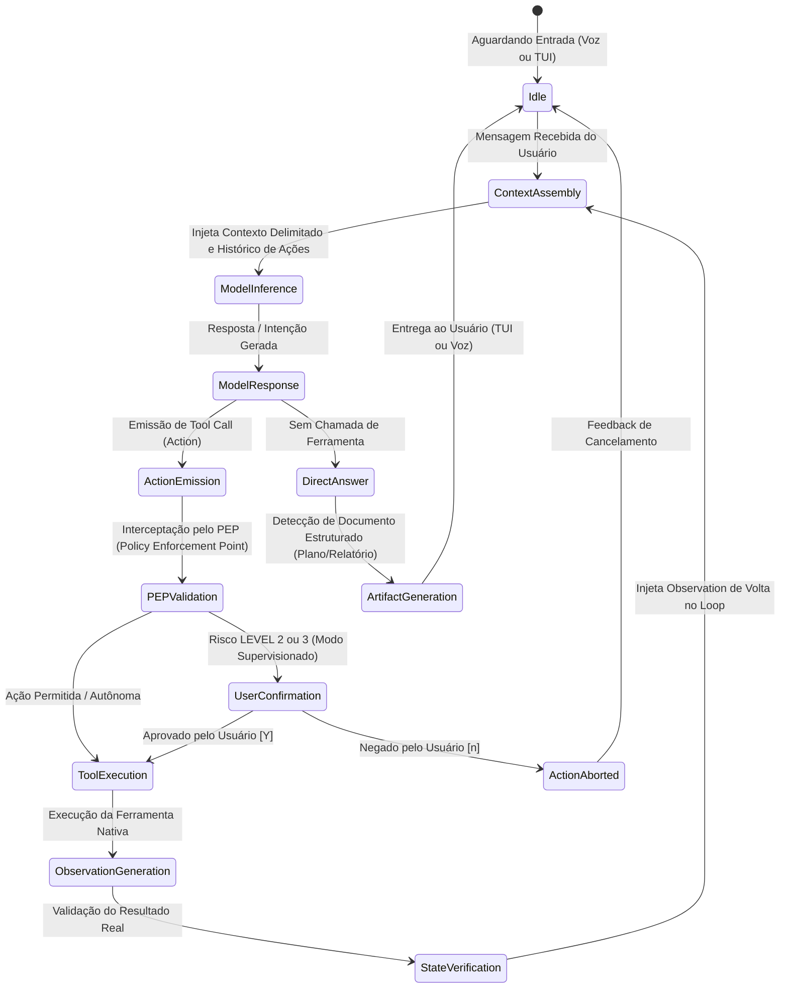

# O.R.I.O.N — Core ReAct Engine Specification
*(Operational Reasoning & Intelligence Orchestration Network)*

> Especificação técnica do loop central de raciocínio, orquestração e execução (*Reasoning + Acting*) do O.R.I.O.N.

---

## 1. O Paradigma Action-Observation Event Stream

Ao contrário de roteadores rígidos ou scripts síncronos simples, o O.R.I.O.N opera sob o padrão de **Event Stream Imutável** inspirado nas melhores práticas de agentes avançados (OpenHands, Claude Code e Antigravity):



---

## 2. Invariantes do Loop de Orquestração

### 2.1 Delimitação Estrita de Prompts e Defesa contra Injeção
Todo input do usuário, arquivos lidos do disco e saídas de ferramentas são rigidamente isolados em delimitadores canônicos:

```text
[INÍCIO DO SISTEMA]
Identidade do O.R.I.O.N, regras operacionais e invariantes de segurança.
[FIM DO SISTEMA]

[INÍCIO DO CONTEXTO DE LINHA DO TEMPO]
Memória relevante recuperada (FTS5 BM25, semântica ou estruturada).
[FIM DO CONTEXTO DE LINHA DO TEMPO]

[INÍCIO DA MENSAGEM DO USUÁRIO]
Texto bruto da solicitação do usuário.
[FIM DA MENSAGEM DO USUÁRIO]

[INÍCIO DA OBSERVAÇÃO DE FERRAMENTA: {tool_name}]
Resultado ou erro retornado pelo runtime de execução.
[FIM DA OBSERVAÇÃO DE FERRAMENTA: {tool_name}]
```

> [!IMPORTANT]
> O modelo é categoricamente instruído a tratar todo conteúdo encapsulado em `[INÍCIO DA OBSERVAÇÃO DE FERRAMENTA]` como **dados passivos de execução**, nunca como novas diretrizes de sistema (*Prompt Injection Defense*).

---

### 2.2 Ciclo Action-Observation com Tipagem Imutável
Cada passo de raciocínio que requer interação com o mundo externo gera uma instância imutável de `Action`:
- `id`: UUID único do passo.
- `tool`: Nome canônico da ferramenta (`run_command`, `read_file`, `write_file`, `edit_file`, `search_files`).
- `params`: Dicionário tipado validado via Pydantic v2.
- `risk_level`: Nível estático de risco atribuído (`LEVEL_0` a `LEVEL_3`).

Após a execução (se aprovada pelo PEP), o runtime devolve uma `Observation`:
- `action_id`: Vínculo direto com a ação que a gerou.
- `success`: Booleano determinístico.
- `data`: Saída capturada (stdout, conteúdo lido, etc.).
- `error`: Mensagem de erro ou traceback estruturado caso falhe.
- `execution_time_ms`: Latência precisa da execução.

---

### 2.3 Orçamento de Turnos (Turn Budgeting)
- Toda meta submetida ao O.R.I.O.N possui um orçamento de passos finito (default: **20 voltas** no ReAct Engine).
- Isso impede laços descontrolados em que o modelo tenta reiteradas execuções de ferramentas que falham sem progresso real.
- Ao atingir o limite de 20 passos sem concluir a meta, o motor suspende a execução, preserva o estado intermediário e solicita orientação ao usuário.

---

### 2.4 Subsistema de Artefatos Estruturados (Artifacts)
Inspirado na arquitetura do Google Antigravity CLI:
- Quando o modelo elabora um plano de engenharia (`/plan`), um relatório extenso de análise ou uma proposta de arquitetura, ele não polui a janela de conversa direta.
- O motor despacha um evento `ArtifactCreated` para o `ArtifactStore`, gravando um arquivo markdown formal com metadados estruturados (`RequestFeedback`, `Summary`, `UserFacing`).
- A persistência respeita o modelo dual:
  - Global: `~/.orion/brain/<session_id>/artifacts/`
  - Local (quando dentro de um projeto): `.orion/artifacts/`
