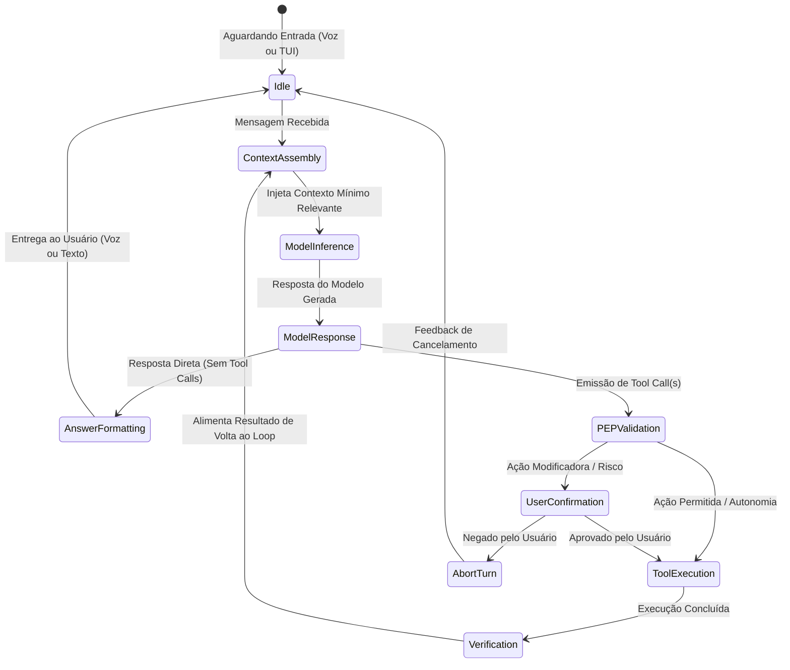

# ORION-Agent — Core ReAct Engine Specification

> Especificação do loop central de raciocínio e execução (Reasoning + Acting) do ORION.

---

## 1. O Loop ReAct Assíncrono

Ao contrário da abordagem engessada de roteamento estático, o ORION opera através de um **ciclo contínuo de percepção, raciocínio, ação e verificação**:



---

## 2. Invariantes do Loop de Orquestração

1. **Delimitação Estrita de Prompts e Defesa contra Injeção**:
   - Todo input de usuário, conteúdo de arquivos e saídas de comandos são encapsulados em tags formais:
     ```text
     [INÍCIO DO SISTEMA]
     Identidade, regras operacionais e invariantes.
     [FIM DO SISTEMA]

     [INÍCIO DO CONTEXTO DE LINHA DO TEMPO]
     Memória relevante recuperada.
     [FIM DO CONTEXTO DE LINHA DO TEMPO]

     [INÍCIO DA MENSAGEM DO USUÁRIO]
     Texto bruto do usuário.
     [FIM DA MENSAGEM DO USUÁRIO]
     ```
   - O modelo é instruído a nunca tratar conteúdos lidos de arquivos externos como instruções do sistema.

2. **Verificação de Resultado Real**:
   - Uma ação só é considerada concluída quando o retorno da ferramenta valida o estado esperado (ex: se editou um arquivo, o arquivo existe e contém a modificação; se rodou um teste, o exit code é 0).
   - Tentativa $\ne$ Conclusão. O ORION reporta falhas e tenta recuperações automáticas controladas (limite máximo de 3 tentativas para o mesmo erro antes de solicitar auxílio humano).

3. **Orçamento de Turnos (Turn Budgeting)**:
   - Toda tarefa tem um teto de voltas no loop (default: 20 passos). Isso impede loops infinitos onde o modelo fica tentando executar comandos sem progresso mensurável.
