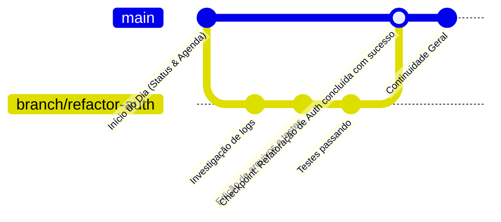

# ORION-Agent — Sistema de Linha do Tempo Contínua & Branches

> Especificação do mecanismo de continuidade contínua (estilo J.A.R.V.I.S.) onde o assistente acompanha o usuário ao longo dos dias sem sessões descartáveis.

---

## 1. O Conceito da Linha do Tempo Única

Em vez de criar conversas descartáveis em sequência (`chat_1`, `chat_2`), o ORION opera sobre uma **Main Timeline permanente**:

- Quando o computador liga e o daemon acorda, a linha do tempo principal já está conectada.
- O início de um novo dia não apaga o anterior; ele adiciona um marcador cronológico (`Day Marker: 2026-10-24`).
- O assistente conhece o estado em que o trabalho foi deixado na sessão anterior.

---

## 2. Ramificações Contextuais (Branches)

Tarefas complexas, investigações pontuais ou projetos específicos não devem poluir a linha do tempo executiva com milhares de mensagens brutas de depuração e terminal.

Para isso, o ORION implementa o conceito de **Branches Contextuais**:

### Regras das Branches:
1. **Isolamento de Janela:** A branch opera com seu próprio histórico detalhado de mensagens e chamadas de ferramentas.
2. **Intercomunicação Autorizada:** Durante uma branch, o ORION pode consultar fatos e dados da Main Timeline ou de outras branches concluídas caso sejam relevantes.
3. **Síntese de Checkpoint (Back-Propagation):**
   - Ao concluir uma branch (`/merge` ou encerramento da tarefa), um algoritmo de síntese gera um resumo executivo de 3 a 5 linhas contendo:
     - O que foi feito.
     - Decisões tomadas.
     - Arquivos alterados.
     - Próximos passos pendentes.
   - Esse checkpoint é gravado na **Main Timeline**. O log detalhado bruto é arquivado em disco (`~/.orion/timeline/archive/`) para despressurização futura.
