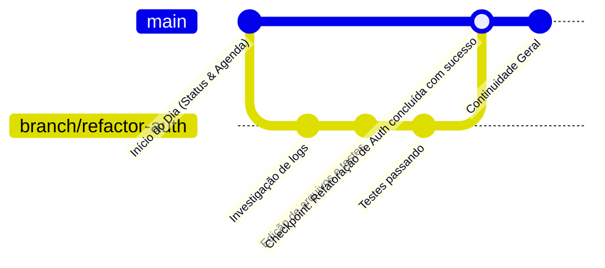

# ORION-Agent — Sistema de Linha do Tempo Contínua, Branches & Dynamic Compactor

> Especificação do mecanismo de continuidade perpétua (estilo J.A.R.V.I.S.), ramificações contextuais (*Branches*) e compactação inteligente de contexto do O.R.I.O.N.

---

## 1. O Conceito da Linha do Tempo Única

Em vez de forçar o usuário a lidar com chats descartáveis (`chat_1`, `chat_2`) que se perdem no esquecimento, o O.R.I.O.N opera sobre uma **Main Timeline permanente**:

- Quando o computador liga e o daemon em segundo plano acorda, a linha do tempo principal já está conectada.
- A virada do dia não apaga o histórico: insere um marcador cronológico imutável (`Day Marker: YYYY-MM-DD`).
- O assistente retoma instantaneamente o estado exato onde o trabalho foi interrompido, mantendo coerência contextual através das semanas.

---

## 2. Ramificações Contextuais (*Branches*)

Investigações detalhadas de bugs, execuções de testes longos ou refatorações profundas não devem inundar a Main Timeline com centenas de linhas de logs de terminal ou tentativas descartadas.

Para isso, o ORION implementa o conceito de **Branches Contextuais**:



### Regras Operacionais das Branches:
1. **Isolamento de Janela de Contexto:** Cada branch opera com seu próprio histórico detalhado de mensagens e chamadas de ferramentas.
2. **Intercomunicação Autorizada:** O agente pode consultar fatos e dados da Main Timeline ou de outras branches concluídas utilizando a ferramenta `recall`.
3. **Síntese de Checkpoint (Back-Propagation):**
   - Ao concluir uma branch (`/merge` ou encerramento da tarefa), o sintetizador gera um resumo executivo de 3 a 5 linhas contendo:
     1. Objetivo atingido.
     2. Decisões arquiteturais tomadas.
     3. Arquivos alterados.
     4. Próximos passos pendentes.
   - Esse checkpoint é gravado como um nó consolidado na **Main Timeline**. O log detalhado bruto é arquivado em disco (`~/.orion/timeline/archive/<branch_id>.jsonl`) para despressurização do contexto.

---

## 3. Dynamic Context Compactor (Compactação Inteligente)

Para garantir que sessões longas não esgotem a janela de contexto ou aumentem os custos de inferência exponencialmente, o ORION possui um motor de compactação dinâmica inspirado nas melhores práticas do Claude Code e aprimorado com retenção de estado de artefatos.

```mermaid
flowchart TD
    Turn[Execução de Turno ReAct] --> CheckBudget{Budget de Tokens >= 80%?}
    CheckBudget -->|Não| Continue[Continua Execução Normal]
    CheckBudget -->|Sim (ou comando /compact)| Compactor[Dynamic Compactor Engine]

    Compactor --> Step1[1. Sumarizar Turnos Antigos & Decisões]
    Compactor --> Step2[2. Purgar Saídas Intermediárias de Ferramentas]
    Compactor --> Step3[3. Preservar Vital Tail - Últimos 3 a 5 Turnos]
    Compactor --> Step4[4. Reler / Preservar Caminhos dos Arquivos Ativos]
    Compactor --> Step5[5. Preservar Metadados de Artefatos Ativos]

    Step1 --> Assemble[Montar Novo Bloco de Contexto Compactado]
    Step2 --> Assemble
    Step3 --> Assemble
    Step4 --> Assemble
    Step5 --> Assemble

    Assemble --> StreamNotify[Notificar Usuário no Stream do Terminal]
    StreamNotify --> Continue
```

### 3.1 Política de Disparo
1. **Auto-Compaction Silenciosa com Notificação (Decisão Homologada):**
   - Quando o contador de tokens da sessão atinge **80% do limite máximo da janela de contexto**, o compactor é acionado automaticamente em segundo plano.
   - Uma mensagem informativa discreta é enviada no stream da TUI:  
     `⚡ [ORION] Compactação de contexto executada: histórico otimizado preservando estado ativo e decisões.`
2. **Compactação Manual (`/compact`):**
   - O usuário pode digitar `/compact` a qualquer momento para limpar o histórico antigo.
   - Suporte a foco direcional (ex: `/compact Focar apenas nas alterações da camada de banco de dados e descartar logs de compilação`).

### 3.2 O que é Purgado vs O que é Preservado

| Categoria | Comportamento do Compactor |
| :--- | :--- |
| **Logs e Retornos de Ferramentas** | Purgados e substituídos por sumários concisos do resultado. |
| **Erros e Stack Traces Superados** | Purgados do prompt imediato (gravados no arquivo de auditoria). |
| **Vital Tail (Turnos Recentes)** | **Preservados na íntegra** (últimos 3 a 5 turnos verbatim) para garantir fluidez no raciocínio. |
| **Arquivos Ativos** | Caminhos dos arquivos modificados ou criados na sessão são preservados com destaque. |
| **Metadados de Artefatos** | Resumos e referências dos artefatos vigentes continuam ativos na memória operacional. |
