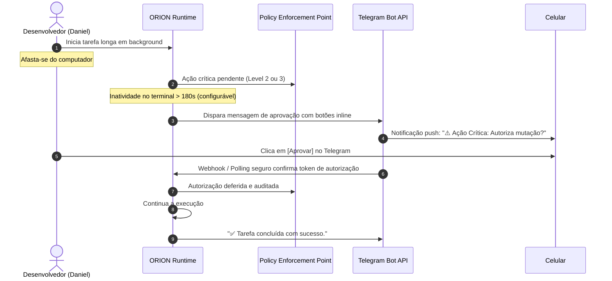

# ORION-Agent — Arquitetura de Memória & As 5 Esferas Cognitivas

> Especificação técnica detalhada dos mecanismos coordenados de armazenamento, recuperação híbrida via RRF, as 5 Esferas Cognitivas e governança cognitiva do O.R.I.O.N.

---

## 1. O Problema da Dependência Vetorial Exclusiva & Poluição de Contexto

A maioria das soluções de agentes modernas (Claude Code, Antigravity, OpenHands, MemGPT/Letta) sofre de falhas graves de arquitetura de memória:
- **Perda de Contexto Temporal:** Embeddings não entendem naturalmente "ontem", "semana passada" ou a ordem cronológica estrita dos acontecimentos.
- **Similaridade Falsa:** Duas frases com vocabulário parecido recebem alta similaridade mesmo que uma trate de um fato descartado e a outra de uma regra vigente.
- **Incapacidade de Buscar Termos Exatos:** Erros de compilação, hashes de commit, nomes de variáveis ou comandos específicos muitas vezes são perdidos em buscas semânticas puras.
- **Envenenamento de Memória (*Memory Poisoning*):** Hipóteses provisórias ou erros investigados pelo modelo acabam gravados no banco vetorial como "verdades", corrompendo decisões futuras.
- **Afogamento de Contexto (*Context Distraction*):** Injetar arquivos inteiros de memória no prompt de sistema consome milhares de tokens, eleva a latência e reduz drasticamente a capacidade de raciocínio do modelo.
- **Cegueira Operacional do Host:** Nenhum agente comercial monitora a saúde física da máquina (RAM/CPU/GPU) antes de disparar ferramentas pesadas como navegadores headless ou processamento multimídia.

---

## 2. A Solução: As 5 Esferas Cognitivas & Memória Tríplice

O ORION organiza todo o conhecimento em **5 Esferas Cognitivas Estritamente Delimitadas**, sustentadas pela **Memória Tríplice Coordenada** (Léxica, Semântica e Estruturada):

```
┌────────────────────────────────────────────────────────────────────────────────────────┐
│                        O.R.I.O.N — AS 5 ESFERAS COGNITIVAS                             │
├────────────────────┬────────────────────┬────────────────────┬─────────────────────────┤
│ 1. User Profile    │ 2. System Identity │ 3. Host Environment│ 4. Project Decisions    │
│    & Human Core    │    & Dual Persona  │    & Health Telemetry│   & Structured Facts    │
├────────────────────┼────────────────────┼────────────────────┼─────────────────────────┤
│ • Nome & "Senhor"  │ • Origem Imutável  │ • RAM/CPU/GPU load │ • Decisões de Repositório│
│ • Tool Mastery Map │   (Daniel Ribeiro) │ • GUI vs Headless  │ • Máquina de Estados    │
│ • Remote HITL (TG) │ • Persona Ativa    │ • Headroom Guard   │   CONFIRMED/DEPRECATED  │
│                    │   (Jarvis / Style) │   (Safe Browser)   │ • Sincronia MEMORY.md   │
├────────────────────┴────────────────────┴────────────────────┴─────────────────────────┤
│ 5. Episodic Timeline & Continuous Stream (SQLite WAL + FTS5 BM25 + ONNX FastEmbed)      │
└────────────────────────────────────────────────────────────────────────────────────────┘
```

### Esfera 1: Perfil do Usuário (`user_profile`)
- **Arquivo Físico:** `~/.orion/profile.json`.
- **Conteúdo Estruturado:**
  - `name`: Nome real do usuário (ex: "Daniel").
  - `call_sign`: Forma preferida de tratamento (ex: `"Senhor"`, `"Daniel"`, `"Comandante"`).
  - `tool_mastery`: Matriz tipada de proficiência do usuário por tecnologia (`expert`, `advanced`, `intermediate`, `beginner`).
    - *Comportamento Adaptativo:* O ORION calibra sua didática. Se o usuário é *expert* em Python, comandos e refatorações são entregues sem preâmbulos didáticos. Se é *beginner* em Rust, o agente antecipa armadilhas de borrow checker e explica termos fundamentais.
  - `remote_escalation`: Configuração para escalonamento remoto out-of-band quando o desenvolvedor estiver longe do PC (veja Seção 6).

### Esfera 2: Identidade do Sistema & Persona Dual (`system_identity`)
- **Arquivo Físico:** `src/orion/core/identity.py` (Kernel Imutável) e `~/.orion/persona.json` (Persona Ativa).
- **Camada Imutável (Origin Truth):**
  - O ORION sabe indelevelmente quem o concebeu: **Daniel** (github: [`danielribeiro-dev`](https://github.com/danielribeiro-dev)), seu propósito de autonomia operacional soberana e segurança determinística sob o pacto O.R.I.O.N.
- **Camada Modular (Active Persona):**
  - `persona_name`: Nome customizável (Padrão: `"ORION"`, customizável para `"Jarvis"`).
  - `style`: Estilo e tom de voz (ex: *"Elegante, refinado, mordomo britânico de alta capacidade técnica; ultra-conciso em shell e execução de tarefas, expansivo e didático em explicações conceituais"*).
  - `tone_rules`: Diretrizes rígidas para evitar cortesias vazias ou bajulação artificial.

### Esfera 3: Ambiente do Host & Telemetria do SO (`system_environment`)
- **Engine:** `src/orion/runtime/environment.py` utilizando `psutil` com fallback para `/proc` do Linux.
- **Telemetria Passiva:**
  - RAM Total vs Disponível (ex: `11.4 GB / 16.0 GB livres`).
  - CPU Load Average (1m, 5m, 15m) e temperatura de hardware.
  - Modo de exibição: `Wayland`, `X11`, ou `Headless/SSH`.
  - GPUs disponíveis (NVIDIA via `nvidia-smi` ou AMD/Intel via `lspci`).
  - Binários homologados no `PATH` (`docker`, `cargo`, `node`, `python`, etc.).
- **Headroom Guard (Guardião de Recursos):**
  - Salvaguarda determinística: Se `ram_available_mb < 1500`, o agente **bloqueia autonomamente** a abertura de instâncias de navegadores pesados (Chromium/Puppeteer) ou processamento multimídia, alertando o usuário e sugerindo alternativas leves (curl, API, texto).

### Esfera 4: Decisões de Projeto & Fatos Estruturados (`project_decisions`)
- **Engine:** SQLite relacional em `.orion/project_memory.db` com sincronização em `.orion/memory/MEMORY.md`.
- **Máquina de Estados de Certeza (Prevenção de *Memory Poisoning*):**
  ```mermaid
  stateDiagram-v2
      [*] --> INFERRED: Agente detecta padrão ou hipótese no código
      INFERRED --> CONFIRMED: Usuário confirma explicitamente ou instrui no chat
      INFERRED --> DEPRECATED: Hipótese refutada por erro ou evidência
      CONFIRMED --> DEPRECATED: Usuário revoga regra antiga formalmente
      DEPRECATED --> [*]
  ```
  - `CONFIRMED`: Informação explícita autorizada pelo usuário. Tem prioridade máxima e nunca é sobrescrita por inferência.
  - `INFERRED`: Hipótese observada pelo agente aguardando validação ou recorrência. Nunca substitui um fato confirmado.
  - `DEPRECATED`: Fato ou convenção antiga formalmente revogada. Permanece no histórico para evitar que o agente volte a cometer o mesmo erro superado.

### Esfera 5: Linha do Tempo Episódica Permanente (`timeline_episodic`)
- **Engine:** SQLite 3 WAL (`~/.orion/timeline.db`) com tabela virtual FTS5 (`porter unicode61`) + `fastembed` ONNX local (`bge-small-en-v1.5`, 384 dimensões).
- **Conteúdo:** Todas as interações, ações de terminal, observações, Day Markers (`DayMarker: YYYY-MM-DD`) e resumos de branches consolidadas.

---

## 3. O Mecanismo Anti-Afogamento: "Progressive Cognitive Unpacking" (PCU)

Para garantir que o LLM opere com velocidade máxima e sem degradação de raciocínio, o ORION adota o **Progressive Cognitive Unpacking**:

```
┌─────────────────────────────────────────────────────────────────────────────┐
│                 INJEÇÃO DE BOOT (COGNITIVE MANIFEST: ~180 TOKENS)           │
├─────────────────────────────────────────────────────────────────────────────┤
│ [ORION COGNITIVE MANIFEST]                                                  │
│ - User: Daniel (Call: "Senhor" | Remote: Telegram Enabled | Level: Adv/Exp) │
│ - Persona: Jarvis (Tone: Elegant butler; concise on shell, deep on theory)  │
│ - Origin: Conceived by Daniel (github: danielribeiro-dev)                   │
│ - Host: Linux 6.x (RAM: 11.2GB/16GB free | Wayland GUI | Browser: Safe)     │
│ - Knowledge: 12 ADRs registered (Use `recall` to unpack project rules)      │
│ - Timeline: 14 sessions recorded on branch 'main'                           │
└─────────────────────────────────────────────────────────────────────────────┘
```

1. **Manifesto Compacto (< 250 tokens):** Apenas metadados de alto nível e ponteiros são injetados no System Prompt.
2. **Desempacotamento Sob Demanda:** Se o usuário faz um pedido de rotina de terminal, o agente executa imediatamente sem ler bancos de dados. Se o usuário questiona uma regra arquitetural, o agente desempacota cirurgicamente via ferramenta `recall`.
3. **Headroom Telemetry sem Prompt Overhead:** O status do host (`Browser: Safe`) é avaliado deterministicamente em código, consumindo zero voltas de LLM.

---

## 4. Persistência em Arquivo: Índice Curado & Logs Diários

Para permitir auditoria humana direta e compatibilidade com o fluxo do desenvolvedor, o ORION sincroniza sua memória em arquivos no disco:

```text
.orion/memory/ (ou ~/.orion/memory/)
├── MEMORY.md                 # Índice curado de alta relevância (teto de 200 linhas)
└── daily/
    ├── 2026-10-24.md         # Notas de trabalho e decisões do dia
    └── 2026-10-25.md
```

- **`MEMORY.md` (Curated Index Pointer):** Arquivo de leitura rápida injetado no boot. Possui um teto rígido de 200 linhas. Informações antigas são compactadas ou movidas para arquivos de tópico especializados.
- **Daily Logs (`daily/YYYY-MM-DD.md`):** Histórico de trabalho cronológico do dia, nunca injetado na íntegra no prompt, mas plenamente consultável via busca híbrida.

---

## 5. Recuperação Híbrida e Algoritmo RRF (Reciprocal Rank Fusion)

Quando o desempacotamento sob demanda é acionado via `recall`, o orquestrador combina os três canais:

```mermaid
flowchart LR
    UserQuery[Prompt do Usuário] --> FTS[Busca BM25 no FTS5]
    UserQuery --> VEC[Busca Cosseno no FastEmbed]
    UserQuery --> KB[Busca Chave-Valor em Fatos CONFIRMED]

    FTS --> RRF[RRF Ranker: 1 / (k + rank)]
    VEC --> RRF
    KB --> Prio[Prioridade Absoluta Determinística]

    Prio --> Merger[Context Budget Assembler]
    RRF --> Merger
    Merger --> FinalPayload[Payload Final Injetado < 1500 Tokens]
```

O algoritmo **Reciprocal Rank Fusion (RRF)** combina as posições ranqueadas dos resultados léxicos e semânticos:

$$RRF(d) = \sum_{m \in M} \frac{1}{k + r_m(d)}$$

Onde $k = 60$, $M$ é o conjunto de métodos de busca e $r_m(d)$ é o ranking do documento no método $m$.

### Teto Orçamentário Estrito
- **Teto Máximo:** 1.500 tokens.
- Fatos `CONFIRMED` entram com prioridade máxima.
- Os melhores itens do ranking RRF preenchem o espaço restante.

---

## 6. Escalonamento Remoto Out-of-Band (HITL via Telegram)

Quando o ORION executa tarefas demoradas em segundo plano ou em modo ambiente/daemon e necessita de autorização **PEP LEVEL_2** (mutação fora do escopo) ou **PEP LEVEL_3** (comandos críticos de sistema):



- **Proteção contra Spoofing:** Apenas o `telegram_chat_id` autenticado pode autorizar.
- **TTL de Validade:** Solicitações expiram em 10 minutos para evitar execuções pendentes obsoletas.
- **Zero Ruído:** Ações seguras de leitura ou rotina nunca acionam o canal remoto.

---

## 7. Ferramentas Cognitivas Nativas no ReAct Loop

O agente interage com as 5 Esferas através de ferramentas cognitivas primitivas:

### 7.1 `memorize`
- **Assinatura:** `memorize(key: str, value: str, category: str, status: FactStatus = INFERRED) -> RuntimeResult`
- **Uso:** Gravar uma regra, convenção ou aprendizado. Se fornecido explicitamente pelo usuário, grava como `CONFIRMED`.

### 7.2 `recall`
- **Assinatura:** `recall(query: str, sphere: str = "all", limit: int = 5) -> RuntimeResult`
- **Uso:** Desempacotar sob demanda registros de uma esfera cognitiva específica ou via RRF global.

### 7.3 `deprecate_fact`
- **Assinatura:** `deprecate_fact(key: str, reason: str) -> RuntimeResult`
- **Uso:** Marcar formalmente uma decisão ou regra anterior como superada, prevenindo regressões cognitivas.

### 7.4 `inspect_environment`
- **Assinatura:** `inspect_environment() -> RuntimeResult`
- **Uso:** Obter a telemetria em tempo real do host (RAM livre, CPU load, modo de display, status de segurança de navegadores).
