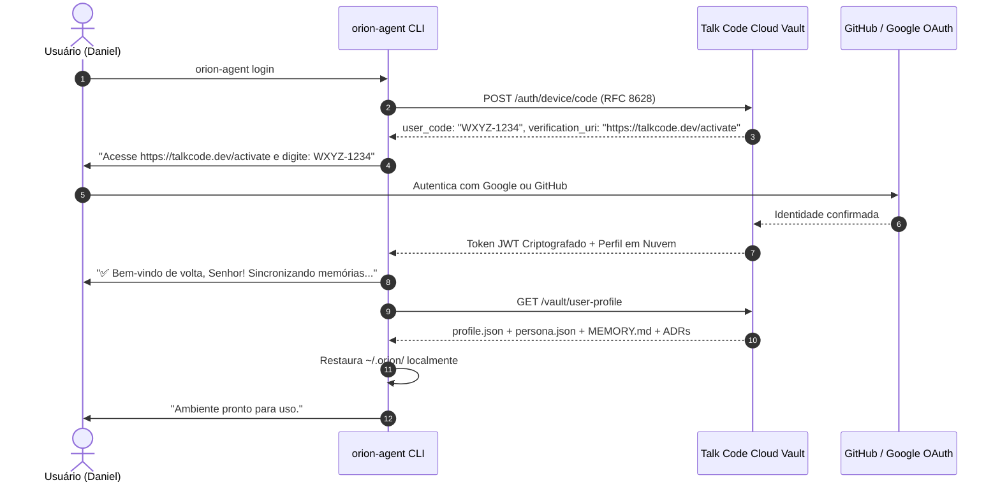

# ORION — Design System, UX de Terminal & Interface Sci-Fi eDEX

> Especificação da experiência do desenvolvedor (UX), onboarding interativo, CLI de alta performance (`orion-agent`) e centro de comando sci-fi imersivo (`orion`).

---

## 1. As Duas Superfícies Oficiais do Sistema

O ORION adota uma separação arquitetural estrita entre duas ferramentas complementares para finalidades distintas:

```
┌─────────────────────────────────────────────────────────────────────────────┐
│                       O.R.I.O.N — AS DUAS SUPERFÍCIES                       │
├──────────────────────────────────────┬──────────────────────────────────────┤
│       orion-agent (CLI de Trabalho)  │          orion (Interface eDEX)      │
├──────────────────────────────────────┼──────────────────────────────────────┤
│ • O motor diário de programação      │ • O Centro de Comando Sci-Fi Imersivo│
│ • Rolagem nativa do terminal         │ • Layout fixo em 4 quadrantes        │
│ • Diffs cirúrgicos e streaming leve  │ • Animação cinematográfica de boot   │
│ • Slash commands (/) e menções (@)   │ • Árvore tátil de arquivos + Gráficos│
│ • Zero sobrecarga de CPU / Bateria   │ • Cockpit de Hardware, Finanças e TG │
└──────────────────────────────────────┴──────────────────────────────────────┘
```

1. **`orion-agent`:** O copiloto de terminal puro. É o comando para o desenvolvedor passar o dia codando com foco extremo, rolagem livre, diffs de código em Rich e autocompletes rápidos com `prompt_toolkit`.
2. **`orion`:** O cockpit visual estilo **eDEX-UI / J.A.R.V.I.S.**, para quem quer a experiência imersiva de ficção científica com animações cósmicas, árvore visual de diretórios, telemetria de hardware e gráficos em tempo real.

---

## 2. Instalação One-Line Curl (`curl | bash`)

A instalação segue o padrão ouro da indústria de ferramentas modernas (Claude Code, Rustup, Bun, Ollama):

```bash
curl -fsSL https://get.orionagent.dev | bash
```

### O que o Script de Instalação Executa:
1. **Detecção do Sistema:** Identifica a distribuição Linux (`Ubuntu`, `Debian`, `Fedora`, `Arch`, `Alpine`, etc.) e arquitetura (`x86_64`, `aarch64`).
2. **Download dos Binários:** Baixa os executáveis pré-compilados do `orion-agent` e do `orion` para `~/.local/bin/`.
3. **Configuração Automática do PATH:** Atualiza automaticamente o `.bashrc`, `.zshrc` ou `.profile` do usuário.
4. **Disparo Imediato:** Transfere o controle imediatamente para o **Wizard de Onboarding Inicial** no terminal.

---

## 3. O Wizard de Onboarding Inicial (Cold Start sem Custo de LLM)

No primeiro contato, **nenhum LLM é acionado**, garantindo inicialização instantânea e zero desperdício de tokens. O terminal conduz uma calibração interativa construída com `prompt_toolkit` e `Rich`:

```text
╭─────────────────────────────────────────────────────────────────────────────╮
│  O.R.I.O.N — Protocolo de Boas-Vindas & Calibração Inicial                  │
╰─────────────────────────────────────────────────────────────────────────────╯

? 1. Como você gostaria de chamar o seu copiloto? [Padrão: Jarvis]: Jarvis
   * Nota: O nome escolhido será a Hotword (ele começará a te escutar por voz
           quando você chamar este nome ou ORION).

? 2. Qual é o seu nome?: Daniel Ribeiro

? 3. Como devo me dirigir a você no dia a dia?
   > [1] Senhor ou Senhora (Formal & Elegante)
     [2] Daniel (Pelo primeiro nome)
     [3] Personalizado...

? 4. Como você prefere a comunicação do agente no terminal?
   > [1] Cirúrgico & Minimalista (direto ao código, sem conversas extras)
     [2] Equilibrado (cordial, explica o necessário)
     [3] Didático & Falastrão (explica detalhadamente cada conceito e passo)

? 5. Selecione suas ferramentas de domínio principal (ou digite abaixo):
   [x] Python (Expert)
   [x] Docker & Containers (Avançado)
   [ ] Rust (Iniciante / Estudando)
   [ ] Kubernetes (Iniciante)
   (Pressione [Enter] para confirmar ou [S] para pular esta etapa agora)
   * Nota: Todas essas preferências podem ser alteradas a qualquer momento em /config.

? 6. Conexão com Modelos & Nuvem:
   > [1] Conectar Conta Talk Code (Ativa ORION LLM dedicado + Cloud Sync)
     [2] OpenRouter / Anthropic / OpenAI / Gemini (Inserir chave API)
     [3] Ollama Local (100% Offline e Privado)
```

### O que o Wizard Realiza:
- Grava localmente as preferências em `~/.orion/profile.json` (Esfera 1) e `~/.orion/persona.json` (Esfera 2).
- Quando o LLM for acionado pela primeira vez, a memória já tem alma e identidade, consumindo zero voltas de ajuste.

---

## 4. Sincronização em Nuvem (Cloud Identity & Device Roaming)

Para evitar a perda de histórico e identidade ao formatar o computador ou trocar de máquina de trabalho:



- **Padrão RFC 8628 (OAuth Device Flow):** O mesmo padrão seguro do GitHub CLI e Claude Code.
- **Zero-Knowledge Encryption:** Chaves e dados confidenciais são criptografados antes do upload.
- **Backup de Conhecimento:** Novas ADRs confirmadas e o índice curado `MEMORY.md` são sincronizados com a nuvem após sessões bem-sucedidas.

---

## 5. Princípios de Experiência do CLI (`orion-agent`)

1. **Fluidez e Não Bloqueio (Rolagem Nativa do Terminal):**
   - O terminal rola solto. O desenvolvedor utiliza o trackpad ou a rodinha do mouse naturalmente, sem janelas ou buffers virtuais travados.
   - Streaming de respostas com renderização de Markdown em tempo real via `Rich.Live`.
   - Indicadores visuais assíncronos não bloqueantes (*spinners*) enquanto ferramentas ou chamadas de modelo estão processando.

2. **Alta Densidade de Informação com Diffs Cirúrgicos:**
   - Modificações de código são apresentadas em painéis de diff cirúrgicos formatados em Rich (verde suave para adições, vermelho suave para remoções), nunca através de dumps brutos de arquivos inteiros.
   - Colapso automático de logs longos (ex: saída de 100 linhas de compilação ou testes é resumida com opção de expandir).

3. **Barra de Entrada Inteligente (Smart Bottom Input):**
   - Cursor responsivo na base do terminal gerenciado por `prompt_toolkit`.
   - Menu flutuante de autocompletar ao digitar `/`, com busca fuzzy e descrições dos comandos.
   - Suporte a `@` para anexar ou citar arquivos locais com expansão automática de caminho.
   - Status bar inferior persistente exibindo modo, modelo, tokens e custos.

4. **Controle Total de Autonomia e Segurança (PEP):**
   - Diálogos claros de permissão com contexto explícito da ação antes de executar qualquer mutação fora do workspace.

---

## 6. O Cabeçalho de Inicialização (*Splash Banner* do CLI)

O cabeçalho renderiza a arte ASCII da **Mão com o Buraco Negro** ([`docs/design/ascii-art.txt`](ascii-art.txt)) com gradiente cyan/azul cósmico, adaptando-se dinamicamente à largura do terminal:

```text
╭─────────────────────────────────────────────────────────────────────────────────────────────╮
│  O.R.I.O.N  v0.2.0 │ Operational Reasoning & Intelligence Orchestration Network            │
│  "Non Ducor, Duco — The Sovereign Cognitive Operating Partner"                             │
├─────────────────────────────────────────────────────────────────────────────────────────────┤
│  ● STATUS: ONLINE (Cloud Gateway)      ● REASONING: HIGH (Depth Thinking Active)            │
│  ● MODEL: claude-3-7-sonnet-thinking   ● GATEWAY: Auto-Routing (Fast/Deep Dynamic)          │
│  ● AUTH: GitHub [@danielribeiro-dev]   ● GOOGLE: daniel.dev@gmail.com (OAuth Connected)     │
│  ● TIMELINE: 42 events today           ● MEMORY: 5 Spheres Active (FTS5 + ONNX + 18 Facts)  │
│  ● PEP GOVERNANCE: Level 2 (Supervised)● WORKSPACE: /home/danieldev/orion-agent             │
╰─────────────────────────────────────────────────────────────────────────────────────────────╯
  Dica: Digite / para comandos rápidos, @ para anexar arquivos ou mencione instruções livremente.
```

---

## 7. Catálogo Oficial dos 20 Slash Commands (`/`)

| Categoria | Comando | Descrição Operacional |
| :--- | :--- | :--- |
| **Cognitivo & Raciocínio** | `/plan <meta>` | Ativa o modo planejamento estrito: pesquisa, gera artefato formal e colhe aprovação. |
| | `/goal <meta>` | Dispara execução autônoma prolongada com auto-recuperação (*Self-Healing*). |
| | `/grill-me` | Entrevista investigativa (Socrática) para esclarecer requisitos antes do código. |
| | `/review` | Revisão crítica de código e segurança nos diffs recentes. |
| **Memória & Habilidades** | `/learn` | Auto-destilação: compila a solução da tarefa em uma nova skill `SKILL.md`. |
| | `/memory` | Inspeciona as 5 Esferas Cognitivas (fatos confirmados, vetores e `MEMORY.md`). |
| | `/timeline` | Exibe a linha do tempo contínua persistente no SQLite com Day Markers. |
| | `/recall <termo>` | Executa busca profunda híbrida RRF para resgatar decisões ou bugs passados. |
| **Contexto & Branches** | `/compact [foco]` | Compactação inteligente preservando *vital tail* e arquivos ativos. |
| | `/context` | Gráfico visual de barras no terminal exibindo a composição da janela de tokens. |
| | `/branch <nome>` | Ramificação de contexto isolada para investigações profundas. |
| | `/merge` | Síntese de checkpoint de 3 a 5 linhas comitada na Main Timeline. |
| **Operação & Governança** | `/diff` | Painel colorido syntax-highlighted de todas as modificações da sessão. |
| | `/undo` | Rollback atômico da última alteração via git checkpoint. |
| | `/run <cmd>` | Execução cirúrgica de comando no SO via PEP. |
| | `/doctor` | Diagnóstico de saúde do ambiente (Python, pacotes, daemon, Ollama, chaves). |
| | `/cost` | Livro-razão financeiro com tokens de entrada, saída, cache e total em USD e BRL. |
| | `/config` | Painel interativo para alternar provedores, modelos, modo auto/fixed, persona e PEP. |
| | `/mcp` | Gerencia conexões e ferramentas do Model Context Protocol (stdio / SSE). |
| | `/voice` | Ativa ou silencia o daemon de presença ambiente e voz headless. |
| | `/clear` | Limpa a visão do terminal sem apagar o histórico de memória. |
| | `/help` | Guia completo de comandos e dicas rápidas de atalhos de teclado. |

---

## 8. A Interface eDEX Sci-Fi (`orion`): O Cockpit de IA

Quando o usuário invoca o comando `orion`, entra em ação o centro de comando imersivo sci-fi.

### 8.1 A Sequência Cinematográfica de Boot (*The Cosmic Boot Sequence*)

```
[Tela Escura / Silêncio Absoluto]
       │
       ▼
[Nome O R I O N surge em tipografia metálica neon ciano]
       │
       ▼
[Linha laser corta o nome ao meio — A Fenda Cósmica]
       │
       ▼
[A MÃO CÓSMICA surge da fenda segurando o BURACO NEGRO em alta definição]
       │
       ▼
[Chuva de código binário e hashes em tons de ciano/azul descendo pela tela]
       │
       ▼
[Mensagem central de saudação: "Olá, Daniel!" (ou "Olá, Senhor!")]
       │
       ▼
[Os 4 quadrantes se desdobram na tela com áudio mecânico sci-fi]
```

### 8.2 O Layout dos 4 Quadrantes do eDEX:

```
┌───────────────────────────────┬─────────────────────────────────────────────┐
│ 1. PAINEL SUPERIOR ESQUERDO   │ 2. PAINEL SUPERIOR CENTRAL / CHAT           │
│                               │                                             │
│ [Imagem Real da Mão Cósmica]  │  Jarvis: "Bom dia, Senhor. Como posso       │
│  Buraco Negro em Alta Def     │          acelerar o seu dia hoje?"          │
│                               │                                             │
│ ● Uptime: 4h 12m              │  Daniel: "Compile o TalkAgent e verifique   │
│ ● Mode: Online (Cloud Gateway)│          se a API do WhatsApp está ativa."  │
│ ● Persona: Jarvis (Butler)    │                                             │
│ ● Creator: Daniel Ribeiro     │  [ Input Box: Digite seu comando...    ]   │
├───────────────────────────────┼─────────────────────────────────────────────┤
│ 3. PAINEL INFERIOR ESQUERDO   │ 4. PAINEL INFERIOR DIREITO                  │
│    (File Explorer Tátil)      │    (Mission Control: Hardware & Custos)     │
│                               │                                             │
│ 📁 /home/danieldev/orion      │  ● RAM: [████████░░] 11.4GB / 16GB (Livre)  │
│  ├─ 🐍 cli.py                 │  ● CPU: [███░░░░░░░] 24% (1m avg: 0.85)     │
│  ├─ ⚙️ pyproject.toml         │  ● GPU: RTX 4060 (38°C | VRAM: 2.1GB/8GB)   │
│  ├─ 📄 README.md              │  ● TOKENS/S: 84 tok/s (Streaming Ultra)     │
│  └─ 📁 docs/                  │  ● CUSTO HOJE: $0.042 (~R$ 0,24)            │
│  [Botões com ícones por ext.] │  ● TELEGRAM HITL: Conectado (@DanvicPhone)  │
└───────────────────────────────┴─────────────────────────────────────────────┘
```

### 8.3 O Cockpit de Hardware, Finanças e HITL (4º Quadrante):
- **RAM Headroom Gauge:** Barra dinâmica que garante que o computador não travará ao abrir navegadores ou processar dados pesados.
- **Tacômetro de CPU & GPU:** Gráfico em tempo real de carga e temperatura de hardware.
- **Velocímetro de Inferência:** Exibe os tokens por segundo do modelo ativo em tempo real.
- **Livro-Razão Financeiro:** Exibe exatamente quantos centavos de dólar e reais a sessão consumiu.
- **Status do Conector Telegram HITL:** Indicador visual de que o celular está pareado e pronto para aprovações out-of-band.

### 8.4 Viabilidade Gráfica:
- **No Terminal Moderno:** Renderização da Mão Cósmica realista através do **Kitty Graphics Protocol** ou **Sixel Graphics** (suportados por Kitty, Ghostty, WezTerm e Alacritty), com fallback para ASCII TrueColor em terminais legados.
- **No Desktop Dedicado (Pós-v1.0.0):** Aplicativo gráfico nativo construído com **Tauri v2 (Rust + WebGL / Three.js)**, entregando 60 FPS com menos de 40MB de RAM.
